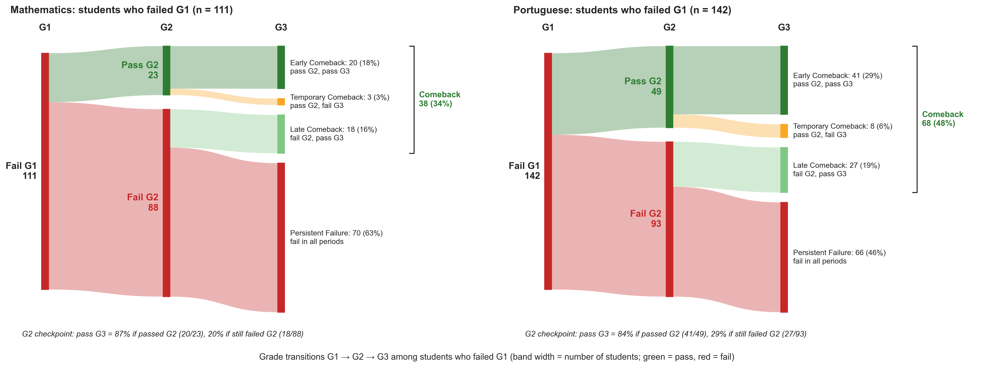
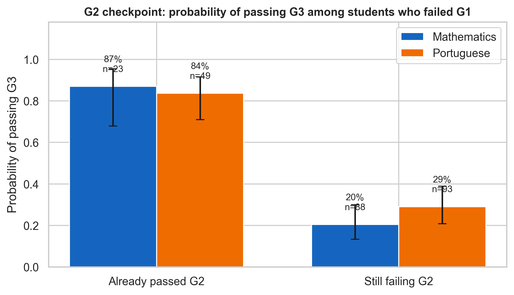
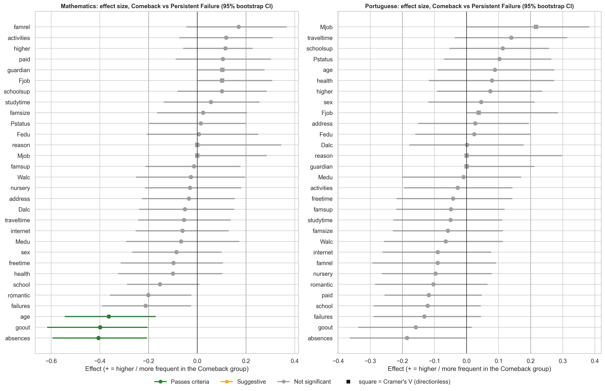
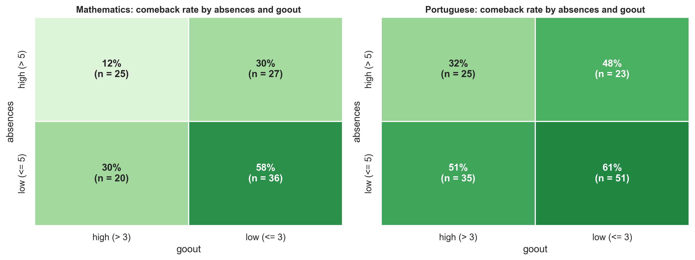

# Student Comeback Analysis: Grade Transitions G1 → G2 → G3

**Group 4 – Data Science Capstone**

Some students fail at the start of the school year but still pass at the end. We call this a **comeback**.
This project looks at students who failed the first grade period (G1) and asks a simple question:

> **What is different about students who come back, compared to students who keep failing?**

---

## Table of Contents

1. [Key Findings at a Glance](#key-findings-at-a-glance)
2. [The Dataset](#the-dataset)
3. [How We Define a Comeback](#how-we-define-a-comeback)
4. [Results](#results)
5. [What This Means for Schools](#what-this-means-for-schools)
6. [Limitations](#limitations)
7. [Project Structure](#project-structure)
8. [How to Run](#how-to-run)

---

## Key Findings at a Glance

| # | Finding | Mathematics | Portuguese |
|---|---------|:-----------:|:----------:|
| 1 | Students who failed G1 | 111 | 142 |
| 2 | Of them, how many made a comeback | **34%** | **48%** |
| 3 | Chance to pass G3 if they **already passed G2** | **87%** | **84%** |
| 4 | Chance to pass G3 if they **still failed G2** | 20% | 29% |
| 5 | Factors that clearly separate comeback students | absences, goout, age | none |

**In short:**
- Many students who fail early can still recover, especially in Portuguese.
- **G2 (the middle period) is the most important checkpoint.** Students who pass G2 have a very good chance to pass in the end.
- In Mathematics, comeback students **miss fewer classes**, **go out with friends less often**, and are **younger**.
- Common ideas like *study time*, *paid tutoring*, or *family support* did **not** make a clear difference.

---

## The Dataset

We use the **[UCI Student Performance](https://archive.ics.uci.edu/dataset/320/student+performance)** dataset.
It comes from two secondary schools in Portugal.

| | Mathematics | Portuguese |
|---|:---:|:---:|
| Students in raw data | 395 | 649 |
| Removed (grade = 0, did not take the exam) | 38 | 16 |
| **Students analysed** | **357** | **633** |

- Grades go from **0 to 20**. A student **passes** with a grade of **10 or higher**.
- Each student has three grades: **G1** (period 1), **G2** (period 2), and **G3** (final grade).
- There are 30 other columns, such as age, absences, study time, family background, and free time.
  See [`data/attribute_descriptions.txt`](data/attribute_descriptions.txt) for the full list.
- About 382 students appear in both files, so we analyse the two subjects **separately**.

---

## How We Define a Comeback

We only look at students who **failed G1**. Then we group them by what happened next:

| Category | G2 | G3 | Meaning |
|----------|:--:|:--:|---------|
| **Early Comeback** | Pass | Pass | Recovered quickly |
| **Late Comeback** | Fail | Pass | Recovered at the end |
| **Temporary Comeback** | Pass | Fail | Recovered, then failed again |
| **Persistent Failure** | Fail | Fail | Never recovered |

**Comeback = Early Comeback + Late Comeback.** We compare this group with the **Persistent Failure** group.

---

## Results

### 1. Many students recover after failing G1



**How to read it:** each band shows a group of students. A wider band means more students. Green means pass, red means fail.

- **Mathematics:** 38 of 111 students (34%) made a comeback. 70 students (63%) failed in every period.
- **Portuguese:** 68 of 142 students (48%) made a comeback. Most of them recovered early, already at G2.

### 2. G2 is the key checkpoint



Among students who failed G1:

- If they **passed G2**, around **85%** passed the final grade.
- If they **still failed G2**, only **20–29%** passed the final grade.

**Takeaway:** G2 is a good moment to check on students. A student who is still failing at G2 needs help quickly.

### 3. Which factors make a difference?

We tested 30 factors and compared comeback students with persistent failure students.



**How to read it:**
- Each dot is one factor. The line around it is the uncertainty range (95% confidence interval).
- A dot on the **left** (negative) means the factor is **lower** in comeback students.
- **Green** = clear result (significant and strong enough). **Grey** = no clear difference.

**Mathematics:** three factors give a clear result.

| Factor | What it means | Comeback students have... |
|--------|---------------|---------------------------|
| `absences` | Number of missed classes | **fewer absences** (average 4.1 vs 9.4) |
| `goout` | How often they go out with friends (1–5) | **go out less often** |
| `age` | Student age | **are younger** |

**Portuguese:** no factor gives a clear result. Absences and going out show the same direction, but the effect is weaker.

**Factors that did *not* make a clear difference** in either subject:
study time, paid tutoring, school support, family support, internet access, and wanting higher education.

### 4. Simple risk profile

Here we combine the two strongest factors: **absences** and **going out**.



**How to read it:** each box shows the comeback rate for one group of students. Darker green means a higher comeback rate.

- **Mathematics:** students with **few absences and who go out less** have a **58%** comeback rate.
  Students with **many absences and who go out a lot** have only **12%**.
- **Portuguese:** the same pattern appears (61% vs 32%), but the gap is smaller.

---

## What This Means for Schools

1. **Do not give up after a bad G1.** One third to one half of these students still pass.
2. **Use G2 as an early warning point.** Students failing both G1 and G2 have a high risk of failing the year.
3. **Watch attendance.** Many absences is the clearest warning sign, especially in Mathematics.
4. **Balance social life and study.** Students who go out very often are less likely to recover.

---

## Limitations

- **Correlation, not cause.** This is observational data. For example, we cannot say that fewer absences *cause* a comeback.
- **Small groups.** Only 108 (Math) and 134 (Portuguese) students are in the main comparison, so some effects may be missed.
- **Two schools only.** The results may not be the same for other schools or countries.

---

## Project Structure

```
.
├── data/                          Raw dataset (UCI Student Performance)
│   ├── student-mat.csv            Mathematics students
│   ├── student-por.csv            Portuguese students
│   ├── attribute_descriptions.txt Meaning of every column
│   └── student-merge.R            Original R script to merge the two files
│
├── notebooks/
│   └── smallproject.ipynb         Main analysis notebook (all steps)
│
├── output/                        Created by the notebook
│   ├── figures/                   Charts (.png)
│   └── tables/                    Statistical results (.csv)
│
├── docs/
│   └── midterm_report_group4.pdf  Midterm report
│
└── README.md
```

### Output file names

Each output file starts with a code that matches a section in the notebook:

| Code | Part | Content |
|------|------|---------|
| A1 | Basic EDA | Data cleaning |
| A2 | Basic EDA | Grade distributions |
| A3 | Basic EDA | Previous grades vs. final grade |
| A4 | Basic EDA | Study time, failures, and absences vs. final grade |
| A5 | Basic EDA | Correlation heatmap |
| A6 | Basic EDA | Factors linked to the final grade |
| B1 | Comeback | Number of students in each category |
| B2 | Comeback | Grade transition flow |
| B3 | Comeback | G2 checkpoint |
| B4 | Comeback | Factor tests |
| B5 | Comeback | Robustness checks (consistency score 0–5) |
| B6 | Comeback | Key factor profiles |
| B7 | Comeback | Mathematics vs. Portuguese |
| B8 | Comeback | Simple risk profiles |

Files ending in `_mat` are for Mathematics, and `_por` for Portuguese.

---

## How to Run

1. **Install Python 3.10 or newer.**
2. **Install the libraries:**
   ```bash
   pip install numpy pandas matplotlib seaborn plotly scipy statsmodels jupyter
   ```
3. **Open the notebook:**
   ```bash
   cd notebooks
   jupyter notebook smallproject.ipynb
   ```
4. **Run all cells** (menu *Run → Run All Cells*).

The notebook reads data from `data/` and saves all results to `output/figures/` and `output/tables/`.

> **Google Colab:** upload `student-mat.csv` and `student-por.csv` when the notebook asks for them.
> Results will be saved in a folder named `analysis_results/`.

---

## Methods (short summary)

For readers who want more detail:

- **Tests:** Mann-Whitney U (numeric and ordinal factors), Fisher's exact test (binary), and chi-square (nominal).
- **Effect size:** rank-biserial correlation, or Cramér's V for nominal factors.
- **Multiple testing:** Benjamini-Hochberg correction (q < 0.05).
- **A factor "passes"** when it is significant (q < 0.05) and has an effect of at least 0.20.
- **Consistency score (0–5):** one point each for being significant, effect ≥ 0.20, still important after controlling for G1, stable in 1,000 bootstrap samples, and same direction in the other subject.
  In Mathematics, `absences` and `goout` score 5/5, and `age` scores 4/5.

Full details and code are in [`notebooks/smallproject.ipynb`](notebooks/smallproject.ipynb).
